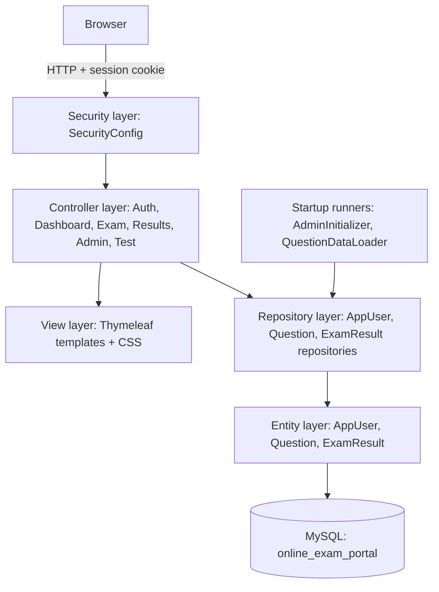
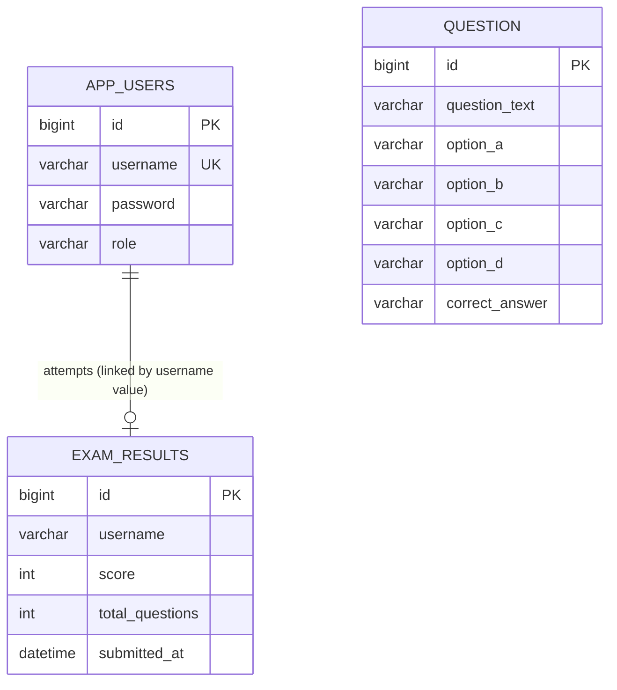
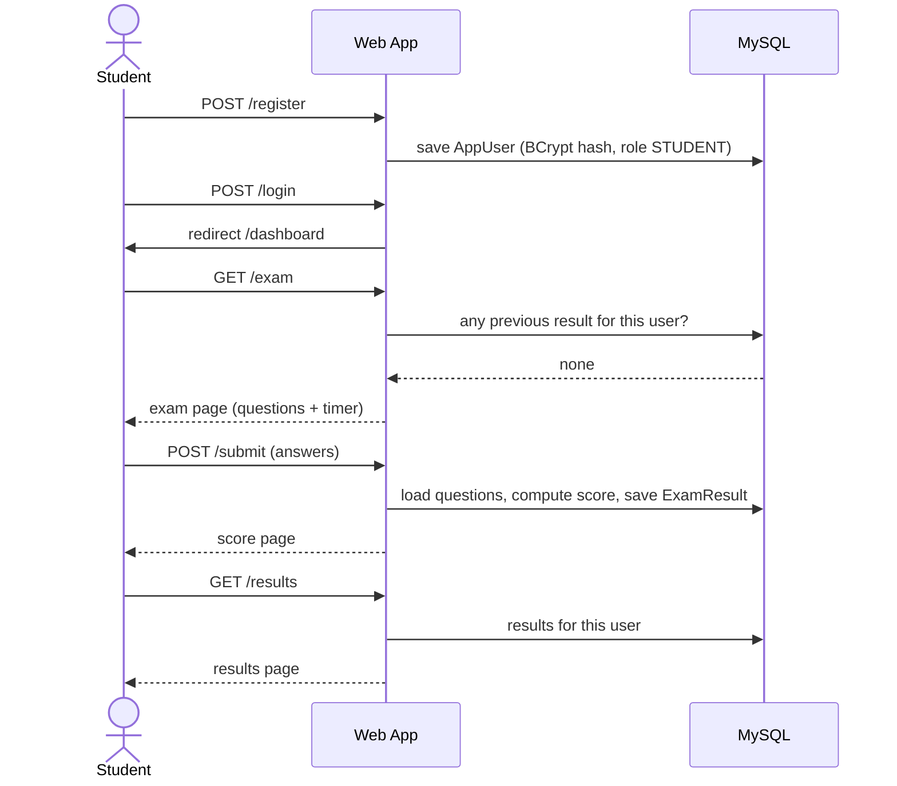

# Online Examination Portal with Result Analysis: Project / Design Report

**Author:** Ranjith (Roll No. 2025103516)
**Repository:** https://github.com/ranjithramesh61827-art/Examportal
**Technologies:** Java 21, Spring Boot 4.0.8, Spring Security, Spring Data JPA, Thymeleaf, MySQL 8.0, Maven

---

## 1. Abstract

The Online Examination Portal is a web application that lets students take a multiple-choice examination online and lets administrators manage the questions and review results. It is built with Spring Boot using a layered MVC architecture, with Spring Security for authentication and role-based access, Thymeleaf for the user interface, and MySQL for persistent storage. Students register, log in, attempt the exam once within a 10-minute countdown, and receive an automatically calculated score that is stored in the database. Administrators can add and delete questions, see summary counts, and view every student's result. This report describes the problem, the design, the implementation, the testing approach, and the current limitations of the system.

## 2. Introduction

Conducting examinations on paper requires printing, manual invigilation, manual marking, and manual record keeping. A web-based portal removes most of this effort: questions are stored once, marking is instant, and results are saved permanently. This project implements a small but complete examination workflow, from account creation to result storage, using widely used Java enterprise technologies.

## 3. Problem Statement

Manual and paper-based objective tests are slow to evaluate, prone to marking errors, hard to store and search, and difficult to restrict to a single attempt per student. There is a need for a simple web system in which:

- students can securely register, log in and take an objective test,
- marking is automatic and accurate,
- each student can attempt the test only once,
- results are stored persistently, and
- administrators can maintain the question bank and view all results without touching the database directly.

## 4. Objectives

1. Provide secure registration and login with hashed passwords.
2. Separate student and administrator capabilities using role-based access control.
3. Present multiple-choice questions and calculate the score automatically.
4. Store users, questions and results in a relational database.
5. Enforce a single attempt per student on the server side.
6. Give administrators a dashboard and tools to manage questions and view results.
7. Keep credentials out of source control.

## 5. Existing System

In a typical manual or semi-manual setup, questions are printed, answer sheets are collected and marked by hand, and marks are recorded in registers or spreadsheets. Drawbacks: delayed results, human marking errors, no central record, no automatic enforcement of attempt limits, and heavy administrative effort.

## 6. Proposed System

A centralised web application where all questions and results live in one MySQL database. Students interact only with the exam pages; administrators access a protected admin area. Marking and result storage happen automatically at submission, and the server checks the attempt limit every time the exam is opened or submitted.

### 6.1 Implemented features

| Area | Feature |
|---|---|
| Accounts | Registration, duplicate-username check, BCrypt password hashing, login/logout |
| Student | Dashboard with username, MCQ exam page, answered counter and progress bar, 10-minute countdown with auto-submit, automatic scoring, result storage, results page, single attempt (server-enforced) |
| Admin | Role-based login, dashboard counts (questions, accounts, attempts), add question, delete question, view all results |
| Data | MySQL persistence via JPA/Hibernate, 5 seeded sample questions, admin account created from configuration |
| Configuration | `application.properties` excluded from Git; `application.properties.example` provided |

### 6.2 Not implemented (verified in source)

| Item | Status |
|---|---|
| Edit existing question | Not implemented (add and delete only) |
| Configurable exam duration | Not implemented; 10 minutes is hard-coded in `exam.html` |
| Server-enforced time limit | Not implemented; timer runs in the browser only |
| Multiple independently managed exams | Not implemented; all questions form one exam |
| Advanced result analytics (averages, rankings, charts) | Not implemented; results are listed only |

## 7. Requirements

### 7.1 Functional requirements
- FR1: A visitor can register a student account with a unique username.
- FR2: A user can log in and log out.
- FR3: A student can open the exam and submit answers.
- FR4: The system calculates the score (1 mark per correct answer) and stores it.
- FR5: A student cannot attempt the exam more than once.
- FR6: A student can view their own result.
- FR7: An administrator can add and delete questions.
- FR8: An administrator can view summary counts and all students' results.

### 7.2 Non-functional requirements
- Security: hashed passwords, CSRF protection, role-based authorization, secrets outside Git.
- Usability: simple pages, progress indicator, countdown warning in the last minute.
- Portability: runs on any machine with JDK 21 and MySQL 8.
- Maintainability: layered code organised by responsibility.

### 7.3 Software requirements

| Item | Requirement |
|---|---|
| JDK | 21 |
| Build tool | Maven (wrapper included) |
| Database | MySQL 8.0 |
| IDE | IntelliJ IDEA (any IDE works) |
| Browser | Any modern browser |

## 8. System Architecture

The system uses a layered architecture: Security, Controller, Repository, Entity/Database, with Thymeleaf templates as the view layer. There is no separate service layer; controllers call repositories directly.

### 8.1 Layer responsibilities

| Layer | Components | Responsibility |
|---|---|---|
| Security | `SecurityConfig` | Authentication, URL authorization, BCrypt encoder, login/logout, CSRF |
| Controller | `AuthController`, `DashboardController`, `ExamController`, `ResultsController`, `AdminController`, `TestController` | Handle HTTP requests, validate input, apply business rules, choose the view |
| View | Thymeleaf templates, `style.css` | Render HTML pages |
| Repository | `AppUserRepository`, `QuestionRepository`, `ExamResultRepository` | Database access through Spring Data JPA |
| Entity | `AppUser`, `Question`, `ExamResult` | Map Java objects to tables |
| Startup | `AdminInitializer`, `QuestionDataLoader` | Seed the admin account and sample questions |

## 9. Modules

### 9.1 Authentication module
Registration (`/register`) validates non-blank input, checks for duplicate usernames, hashes the password with BCrypt, and saves the user with role `STUDENT`. Login uses Spring Security form login; a custom `UserDetailsService` loads the user from MySQL. After login, users are redirected to `/dashboard`.

### 9.2 Student module
The dashboard (`/dashboard`) shows the username and hides the start-exam option when a result already exists. `/exam` lists all questions and renders a countdown timer and progress bar. `/submit` grades the answers and stores the result. `/results` lists the student's saved results.

### 9.3 Administrator module
All routes under `/admin/**` require role `ADMIN`. The dashboard shows counts, `/admin/questions` supports adding and deleting questions with validation (all fields required, correct answer must be A, B, C or D), and `/admin/results` shows all results.

### 9.4 Data initialisation module
`AdminInitializer` creates the admin account from `app.admin.username` and `app.admin.password` if it does not exist. `QuestionDataLoader` inserts five sample questions when the question table is empty.

## 10. Database Design

Database: `online_exam_portal` (tables created by Hibernate with `ddl-auto=update`).

### 10.1 ER diagram

`EXAM_RESULTS.username` refers to `APP_USERS.username` by value only; no foreign key is declared. `QUESTION` is standalone: the exam is simply all rows in this table.

### 10.2 Table descriptions

| Table | Entity | Purpose |
|---|---|---|
| `app_users` | `AppUser` | Student and admin accounts; `role` is `STUDENT` or `ADMIN`; password stored as BCrypt hash |
| `question` | `Question` | Question text, four options, and the correct option letter |
| `exam_results` | `ExamResult` | One row per submitted attempt: username, score, total questions, submission time |

## 11. Implementation

### 11.1 Scoring logic (`ExamController.submitExam`)
For each question, the controller reads the request parameter `question_<id>` and compares it, case-insensitively, with the stored `correctAnswer`. Each match adds one to the score. Unanswered questions score zero. The total number of questions at that moment is stored with the score.

### 11.2 Single-attempt rule
Both `GET /exam` and `POST /submit` call `findByUsernameOrderBySubmittedAtDesc(username)`; if the list is not empty, the user is redirected to `/results`. Checking in `POST /submit` as well prevents a retake by posting directly or by using an old open page.

### 11.3 Security configuration
- Public: `/`, `/home`, `/login`, `/register`, `/css/**`, `/js/**`
- `/admin/**`: role `ADMIN`
- Everything else: authenticated
- Logout invalidates the session and deletes `JSESSIONID`
- CSRF tokens are included in forms

### 11.4 Countdown timer
Implemented in JavaScript inside `exam.html`: 600 seconds, updated every second, warning style at 60 seconds or less, and automatic form submission at zero. Because this runs in the browser, it is a convenience, not a server-enforced limit.

### 11.5 Configuration and secrets
Database and admin credentials are in `application.properties`, which is listed in `.gitignore`. A template, `application.properties.example`, documents the required keys.

## 12. Application Workflow

**Administrator flow:** log in with configured credentials, land on `/admin/dashboard`, open `/admin/questions` to add or delete questions, open `/admin/results` to review all results.

## 13. Testing

Testing was performed manually through the browser (navigation, authentication, database persistence and the attempt restriction). The table below lists the cases to record in the final submission; fill in the **Result** column from your own runs.

| # | Test case | Steps | Expected result | Result |
|---|---|---|---|---|
| 1 | Register new student | `/register` with a new username | Redirect to `/login?registered`; row in `app_users` with BCrypt hash | |
| 2 | Duplicate username | Register the same username again | "That username already exists." | |
| 3 | Blank fields | Submit register form with empty password | "Username and password are required." | |
| 4 | Student login | Valid credentials | Redirect to `/dashboard` | |
| 5 | Wrong password | Invalid credentials | Redirect to `/login?error` | |
| 6 | Protected page | Open `/exam` while logged out | Redirect to `/login` | |
| 7 | Take exam | Answer and submit | Score shown; row in `exam_results` | |
| 8 | Retake blocked (UI) | Return to dashboard | Start-exam option hidden | |
| 9 | Retake blocked (URL) | Open `/exam` after submitting | Redirect to `/results` with message | |
| 10 | Timer auto-submit | Wait for the timer to reach 00:00 | Form submits automatically | |
| 11 | Student on admin URL | Open `/admin/dashboard` as student | 403 Forbidden | |
| 12 | Admin login | Configured admin credentials | Redirect to `/admin/dashboard` with counts | |
| 13 | Add question | Valid form | Message "Question added successfully!" | |
| 14 | Invalid correct answer | Correct answer `E` | "Correct answer must be A, B, C, or D." | |
| 15 | Delete question | Delete one question | Message "Question deleted successfully!" | |
| 16 | Admin results | Open `/admin/results` | All attempts listed | |
| 17 | Health check | `GET /test` while logged in | `Spring Boot is working successfully!` | |

The project also contains the default Spring Boot test `OnlineExamPortalApplicationTests` (application context load). No other automated tests exist.

## 14. Limitations

- Question editing is not available; questions can only be added or deleted.
- The 10-minute duration is fixed in the page script and is not enforced by the server.
- Only one exam exists; all questions belong to it.
- Results are listed but not analysed (no averages, ranking or charts).
- No service layer, pagination or extensive automated tests.
- `exam_results.username` is not a database foreign key and uniqueness of one attempt is enforced in code, not by a constraint.
- Debug `System.out.println` statements remain in `AdminController`.
- The "Take Exam Again" link on the submitted exam page points to `/`; retakes are rejected by the server.

## 15. Future Enhancements

1. Edit-question feature.
2. Server-side exam duration with configurable length per exam.
3. Multiple exams with separate question sets, schedules and attempt limits.
4. Result analytics: average, highest and lowest scores, per-question accuracy, charts, CSV/PDF export.
5. Foreign keys and a unique (user, exam) constraint in the database.
6. Introduce a service layer, pagination and unit/integration tests.
7. Question randomisation, negative marking and password reset.

## 16. Conclusion

The project delivers a working end-to-end online examination system: secure registration and login, role-based access, a timed MCQ exam with automatic scoring, server-enforced single attempts, persistent storage in MySQL, and an administrator area for question management and result viewing. The documented limitations show clear next steps, notably editing questions, server-enforced timing, multiple exams and result analytics.

## 17. Suggested Screenshots and Figures

| # | Item | Place in |
|---|---|---|
| 1 | Home page | Section 9 |
| 2 | Registration page (with and without the duplicate-username error) | Section 9.1 |
| 3 | Login page | Section 9.1 |
| 4 | Student dashboard (before and after taking the exam) | Section 9.2 |
| 5 | Exam page showing timer and progress bar | Section 9.2 / 11.4 |
| 6 | Score page after submission | Section 9.2 |
| 7 | Results page | Section 9.2 |
| 8 | Admin dashboard with counts | Section 9.3 |
| 9 | Question management page | Section 9.3 |
| 10 | Admin results page | Section 9.3 |
| 11 | MySQL `SHOW TABLES;` and `SELECT * FROM app_users;` (show hashed passwords) | Section 10 |
| 12 | `SELECT * FROM exam_results;` | Section 10 |
| 13 | Retake-blocked message | Section 11.2 |
| 14 | 403 page for a student opening an admin URL | Section 11.3 |
| 15 | Browser showing `/test` response | Section 13 |

The architecture, ER and sequence diagrams above are written in Mermaid and render automatically on GitHub; for a Word or PDF submission, export them as images (for example from https://mermaid.live).
